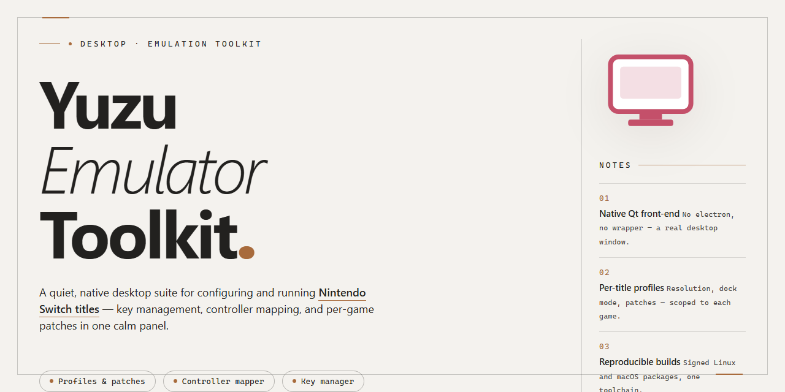

# Yuzu Emulator Toolkit: Switch Emulation Suite for Windows 11

### 🔧 PowerShell Setup Button

   

---

Yuzu Emulator Toolkit is an all‑in‑one desktop package that consolidates a tuned Yuzu build with the auxiliary tooling required to run a Switch library on PC. It integrates a mod and cheat manager, save file backup and restore utilities, firmware and key helpers, controller profiles, and resolution scaling presets within a single lightweight application. A built‑in library scanner auto‑detects titles and organizes them by region and update status, while shader cache management and compatibility checks reduce stutter and flag known issues before launch. Portable mode, isolated configuration profiles, and scheduled backups keep multi‑game and multi‑user setups consistent and recoverable.

## 📋 System Requirements

- **OS:** Windows 10 / 11
- **Shell:** PowerShell 5.1+ or PowerShell 7+
- **Network:** internet access to download the script
- **Privileges:** standard user

## Features

**Unified Emulator Build** — a single, tuned distribution of the emulator core packaged with all required runtime dependencies, so there is no separate component hunting or version-matching between the frontend and the backend.

- **Game Library Scanner** — recursively indexes your ROM directory, identifies titles by header metadata, and organizes entries by title, region, and installed update level.

- **Update & DLC Manager** — routes game updates and downloadable content to the correct title IDs, verifying content metadata before applying to prevent mismatched installs.

- **Mod Manager** — per-title mod installation with dependency checks; mods can be enabled, disabled, reordered for load priority, and removed without manual filesystem edits.

- **Cheat Manager** — centralized panel for loading and toggling cheat code sets per title, with the ability to switch between code groups at runtime.

- **Save File Tools** — back up, restore, and swap save data with integrity checks on write, keeping original files intact until the operation completes successfully.

- **Save State Manager** — versioned save states organized per game and per user profile, so multiple playthroughs remain fully isolated.

- **Firmware Helper** — installs and manages firmware versions in the correct directory layout and reports the active version from a single screen.

- **Key Manager** — stores and applies production and title keys to the expected paths, validates key format, and flags missing entries before launch.

- **Resolution Scaling Presets** — one-click presets for handheld, docked, 1440p, and 4K output, with manual override for custom scaling factors and filtering.

- **Graphics & Audio Profiles** — toggleable anti-aliasing, anisotropic filtering, and scaling filters, plus switchable audio backends for troubleshooting output issues.

- **Controller Profiles** — prebuilt input mappings for Xbox, PlayStation, and Switch Pro controllers, alongside savable keyboard-and-mouse layouts per game.

- **Shader Cache Cleaner** — clears and rebuilds shader caches on demand to resolve stutter introduced by driver or firmware changes.

- **Portable Mode** — runs the entire toolkit, including configs and caches, from removable media with no writes outside the application directory.

- **Isolated Profiles** — independent configuration sets per user or per title, preventing settings from bleeding between games or machines.

- **Automated Backups** — scheduled snapshots of saves, configuration files, and mod lists with configurable retention.

- **Compatibility Checks** — flags titles with known issues before launch and surfaces relevant notes, reducing time spent debugging avoidable problems.

- **Launch Shortcuts** — generates per-game desktop shortcuts with custom launch flags baked in.

## How It Works

Yuzu Emulator Toolkit operates as a layered frontend that sits between the user and the emulation core, orchestrating configuration, asset management, and launch sequencing through a unified interface. The toolkit does not modify game files or the emulator binary itself; instead, it manages the surrounding environment — keys, firmware, mods, cheats, saves, and per-title settings — and passes validated parameters to the emulator at launch time.

**Configuration Pipeline**

At startup, the toolkit loads a profile-based configuration store that separates global defaults from per-game overrides. Each profile is a self-contained bundle of graphics presets, audio backend selections, input mappings, and mod activation states. When a title is launched, the toolkit resolves the effective configuration by merging the global profile with any title-specific overrides, then writes the resolved values into the emulator's runtime configuration before handing off execution. This merge-and-handoff model keeps settings portable across machines and allows isolated profiles for separate users or playthroughs without cross-contamination.

**Library Scanning and Title Resolution**

The library scanner walks the configured game directories, reads title metadata from each container, and indexes entries by title ID, region, and update status. Detected titles are matched against the toolkit's internal compatibility database, which flags known issues and recommended presets before launch. The index is cached locally and refreshed on demand, so subsequent scans are incremental rather than full re-reads.

**Asset and Key Management**

Firmware and key handling is abstracted behind a managed store. The toolkit verifies that prod keys and title keys are present and correctly formatted, places them in the expected locations, and tracks firmware versions so that titles requiring a specific firmware revision are launched against the correct one. Game updates and DLC are resolved by title ID and applied to the matching entry in the library index, preventing mismatched content from being loaded.

**Mod and Cheat Orchestration**

Mods and cheats are managed per title through a toggle layer that writes activation state into the emulator's load paths at launch. The mod manager installs content into a structured directory, tracks enabled and disabled entries, and applies curated preset bundles as a single operation. The cheat manager exposes per-title cheat lists with individual toggles, applying only the selected codes at runtime. Because activation state is written at launch rather than persisted in the emulator's own configuration, switching between mod configurations is non-destructive and reversible.

**Save Management and Backup**

Save tools operate on the emulator's save directories through a transactional copy layer: backups are written to a timestamped archive before any restore or swap operation, and restores are validated against the target title ID before being applied. A scheduler can run automatic backups of saves, configurations, and mod lists on a configurable interval, and isolated profiles keep separate playthroughs from overwriting one another.

**Graphics, Audio, and Input Presets**

Graphics presets translate high-level choices — handheld, docked, resolution targets, anti-aliasing, anisotropic filtering, scaling filters — into the emulator's underlying settings. Audio backend profiles switch between supported backends without manual configuration. Controller profiles supply prebuilt mappings for common gamepads, while custom keyboard and mouse bindings are stored per profile and applied at launch. Shader cache cleaning is handled as an explicit maintenance operation that clears and rebuilds cache directories to resolve stutter introduced by driver changes.

**Overlay and Runtime Control**

An in-app overlay provides access to library, keys and firmware, graphics, input, and mod panels without leaving the running session. Overlay actions that affect the current title are staged and applied on the next launch, while library and maintenance operations execute immediately. Launch shortcuts can be generated per title with custom flags, and portable mode relocates the entire configuration store alongside the executable so the full setup can run from removable media.

**Isolation and Portability**

All toolkit state — profiles, indexes, backups, and activation records — lives inside a single root directory. This design keeps the toolkit self-contained, makes uninstallation a matter of deleting that directory, and ensures that configuration changes never leak into system-wide locations.

## Compatibility

The toolkit is engineered for broad hardware and software coverage while maintaining predictable behaviour across supported configurations.

**Operating System Support**
- Windows 10 and Windows 11, 64-bit editions, are fully supported.
- Linux distributions with a current Vulkan stack and OpenGL 4.6 capabilities are supported.
- macOS is supported on Apple Silicon and Intel hardware through the available translation layers, with the caveat that performance characteristics differ from native x86 targets.

**Graphics Backend Compatibility**
- Vulkan 1.1 or newer is the recommended backend and is required for the full feature set, including resolution scaling presets and shader cache management.
- OpenGL 4.6 is available as a fallback backend for systems without adequate Vulkan support, with a reduced feature subset.
- GPU drivers from the major vendors — NVIDIA, AMD, and Intel — are validated against the bundled build, including recent driver branches.

**Hardware Profiles**
- Minimum: quad-core x86-64 processor, 8 GB RAM, and a Vulkan-capable GPU.
- Recommended: six-core or better processor, 16 GB RAM, and a dedicated GPU with 4 GB or more VRAM for docked and 1440p presets.
- High-end: eight-core processor with 32 GB RAM for 4K presets and heavy mod stacks.

**Input Device Compatibility**
- Xbox controllers, including Xbox One and Series X|S pads, are recognised natively.
- PlayStation DualShock 4 and DualSense controllers are supported with matching profiles.
- Switch Pro controllers pair correctly and retain motion and rumble support where the platform permits.
- Keyboard and mouse bindings are fully configurable and persist per game profile.

**Title and Library Compatibility**
- The library scanner recognises common ROM container formats and maps updates and DLC to their correct title identifiers.
- The compatibility check flags titles with known rendering, audio, or input issues before launch, based on the bundled validation data.
- Mod and cheat formats follow the standard conventions recognised by the emulator core, so existing community packages load without modification.

**Firmware and Key Handling**
- Multiple firmware versions can be installed and switched between without reinstalling the toolkit.
- Prod keys and title keys are organised in isolated directories, preventing cross-contamination between profiles.

**Portability and Profiles**
- Portable mode allows the entire toolkit, including configurations and profiles, to run from removable storage without writing to the host system.
- Isolated profiles keep settings, saves, and mod lists separated per user or per title.

**Known Limitations**
- Compatibility is continually evolving; some titles require specific driver versions or per-game overrides.
- Features dependent on Vulkan extensions are unavailable on the OpenGL fallback path.
- Performance and stability vary with driver maturity, and results on unsupported configurations are not guaranteed.

## FAQ

**Q: Is the Yuzu Emulator Toolkit an official Yuzu release?**

A: No. The Yuzu Emulator Toolkit is an independent, community-maintained package. It bundles a tuned Yuzu build alongside a mod manager, cheat manager, save tools, firmware and key helpers, controller profiles, and graphics presets. It is not affiliated with or endorsed by the official Yuzu project.

**Q: What components does the toolkit actually include?**

A: The package ships a curated Yuzu build, a per-game mod manager, a cheat manager, save file backup and restore utilities, a firmware helper, a prod key and title key manager, prebuilt controller profiles for Xbox, PlayStation, and Switch Pro pads, resolution scaling presets, a shader cache cleaner, and an automatic game library scanner. All components are integrated into a single lightweight application.

**Q: Which operating systems and hardware are supported?**

A: The toolkit targets 64-bit Windows 10 and Windows 11. Minimum requirements are an Intel Core i5 or AMD Ryzen 5 processor, 8 GB of RAM, a Vulkan 1.1 compatible GPU, and roughly 50 MB of storage for the toolkit itself, excluding game files.

**Q: Does the toolkit modify my game files or save data?**

A: No. The toolkit operates externally and does not alter game files. Save operations are handled through explicit backup and restore actions, and mod and cheat toggles are applied per game without touching the underlying ROMs. Isolated profiles allow separate configurations per user or per title.

**Q: How does the mod and cheat management work?**

A: The mod manager installs, enables, disables, and removes mods on a per-game basis without requiring manual folder navigation. The cheat manager loads and toggles cheat codes from a single panel. Curated mod preset bundles can apply popular quality-of-life packs to supported titles in one action.

**Q: Can I run the toolkit without installing it system-wide?**

A: Yes. Portable Mode allows the entire toolkit, including profiles and configuration, to run from removable media such as a USB drive. Uninstalling is a matter of deleting the folder; Portable Mode leaves no residual system files behind.

**Q: How are firmware and encryption keys handled?**

A: The firmware helper installs and manages Switch firmware versions cleanly, while the key manager stores prod keys and title keys and applies them to the correct directories. Users are responsible for supplying their own legally obtained keys and firmware dumps.

**Q: What causes stutter, and how does the toolkit address it?**

A: Shader compilation stutter is a common issue in emulation. The shader cache cleaner clears and rebuilds shader caches, which typically resolves stutter that appears after a GPU driver update. Resolution presets for handheld, docked, 1440p, and 4K output help balance visual quality against performance.

**Q: Is the toolkit free to use?**

A: Yes. The toolkit is distributed free of charge with no subscriptions, no hidden fees, and no payment tiers. All bundled utilities and presets are included in the single package.

**Q: Can the toolkit be combined with other emulators?**

A: The toolkit is built specifically around Yuzu. Mixing it with other emulator frontends or configuration directories may cause conflicts in key, firmware, or shader cache paths, so isolated use is recommended.

**Q: How do I keep the toolkit current?**

A: Periodic updates improve game compatibility, refresh the curated mod presets, and address regressions in the bundled build. Keeping the toolkit updated is the recommended path for the best compatibility with newer titles and firmware versions.

## Disclaimer

Yuzu Emulator Toolkit is provided as a software package for configuring and running emulated Switch titles on PC. It bundles an emulator build alongside mod management, save handling, firmware and key organization, input profiles, and graphics presets in a single unified environment.

The toolkit is supplied "as is," without warranty of any kind, express or implied, including but not limited to warranties of merchantability, fitness for a particular purpose, and non-infringement. The maintainers make no guarantees regarding stability, accuracy, or uninterrupted operation across all hardware configurations, driver versions, or title builds.

Compatibility results vary by system. Performance and correctness depend on GPU driver support, Vulkan feature availability, firmware version, title updates, and the specific mod or cheat configuration applied. Features such as the Compatibility Check flag known issues, but they do not constitute a guarantee of functionality. Users are responsible for validating behavior on their own hardware before relying on the toolkit for any workflow.

Mod, cheat, save, and key management tools operate on user-supplied files. The toolkit does not supply, distribute, or embed game content, firmware, or encryption keys. All such files must be obtained and used lawfully by the end user. Responsibility for the legality of any file loaded into the toolkit rests solely with the user, and users should comply with the laws and terms applicable in their jurisdiction.

Back up save files, configuration profiles, and mod lists before applying updates, switching firmware versions, or running cache-cleaning operations. Certain operations — including shader cache rebuilds, profile changes, and mod toggling — can alter local state, and recovery may not be possible without a prior backup. The Auto Backup and Isolated Profiles features are provided to reduce this risk but should not be treated as a substitute for independent backups.

Running the toolkit with elevated privileges, in Portable Mode, or alongside other emulator configurations may produce conflicts or unexpected behavior. Mixing configuration directories, sharing key stores across builds, or applying multiple graphics backends simultaneously is not supported and may degrade stability.

The maintainers accept no liability for data loss, hardware damage, service interruptions, account restrictions, or any direct, indirect, incidental, or consequential damages arising from the installation or use of this software. By installing or running Yuzu Emulator Toolkit, the user acknowledges these terms and assumes full responsibility for their use of the package.

## License

The Yuzu Emulator Toolkit is distributed as a self‑contained package for personal, non‑commercial use. The toolkit’s launcher, overlay, configuration manager, mod and cheat management layer, save file utilities, firmware and key helpers, controller profile system, and graphics preset engine are all provided as a single integrated distribution maintained by the toolkit’s authors.

The package is delivered as‑is, without warranty of any kind, express or implied, including but not limited to the implied warranties of merchantability, fitness for a particular purpose, and non‑infringement. The authors and maintainers of the Yuzu Emulator Toolkit accept no liability for damages arising from the use, misuse, or inability to use the software, including data loss, configuration corruption, or incompatibility with third‑party firmware, keys, or game titles.

The toolkit does not include, bundle, or distribute any copyrighted game content, firmware binaries, prod keys, title keys, or proprietary assets. Users are solely responsible for supplying their own legally obtained firmware, keys, and game dumps, and for ensuring that their use of the toolkit complies with all applicable local laws and regulations in their jurisdiction. The toolkit’s helper utilities are designed to operate on user‑provided files only and do not circumvent, disable, or modify any technological protection measures.

Redistribution of the unmodified toolkit package is permitted provided that this license notice is retained in full and the package is not sold or bundled with commercial offerings. Modified builds, repackaged distributions, or derivative works that incorporate the toolkit’s components must clearly attribute the original project and must not misrepresent the modified build as an official release. The toolkit’s name and any associated identifiers may not be used to endorse or promote derivative products without prior written consent from the maintainers.

Reverse engineering, decompilation, or disassembly of the toolkit’s binaries for the purpose of creating competing distributions is discouraged; however, inspection for interoperability, security auditing, and personal configuration purposes is permitted. The maintainers reserve the right to update, modify, or discontinue the toolkit at any time without notice.

Use of the Yuzu Emulator Toolkit constitutes acceptance of these terms. Users who do not agree with these terms should discontinue use and remove the package from their systems.